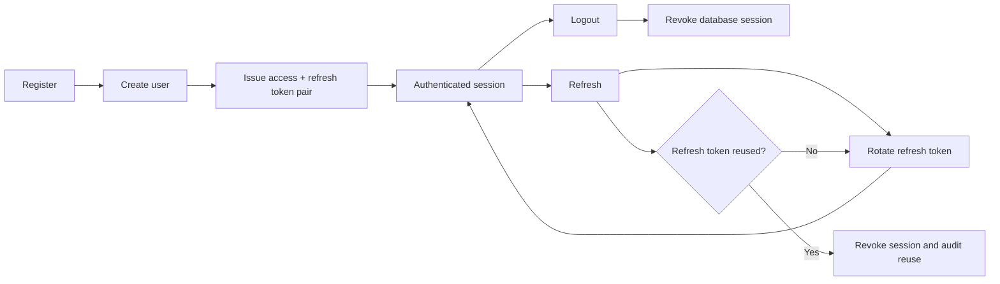
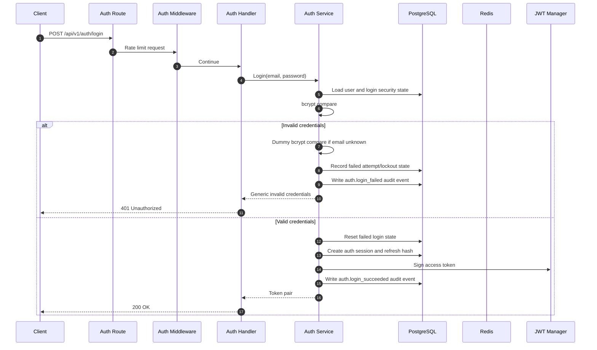
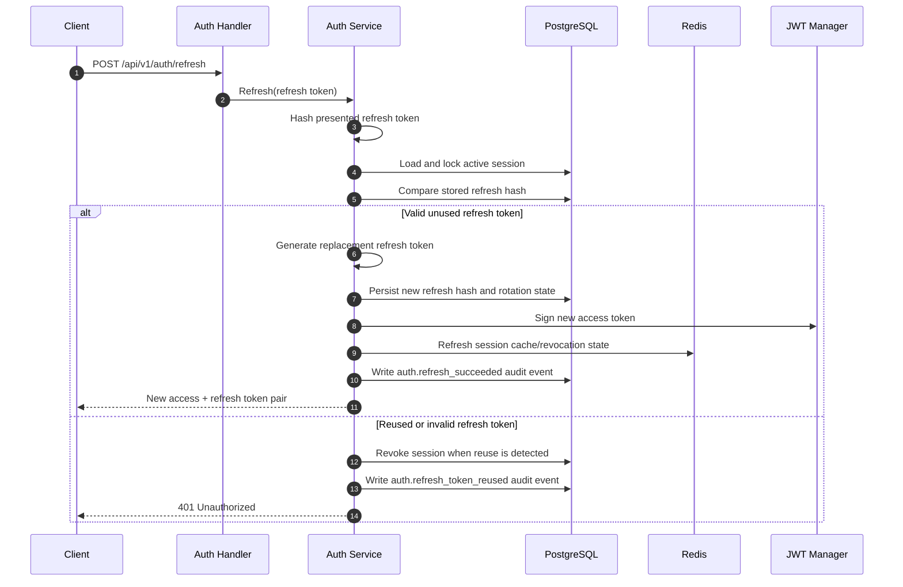
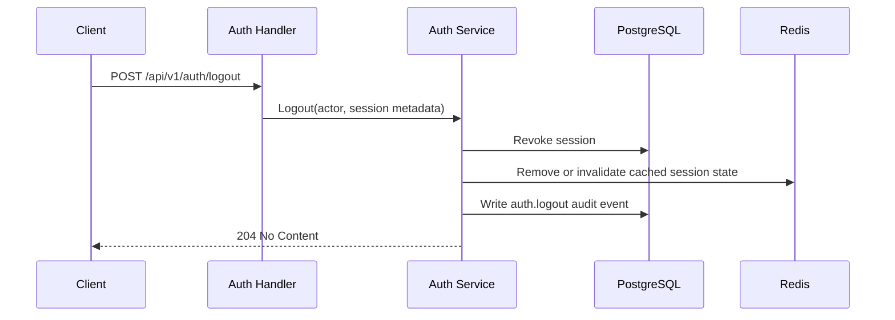

# Authentication and Session Lifecycle

This document traces registration, login, refresh-token rotation, refresh-token reuse detection, and logout.

## Flow overview

## Login flow

## Refresh-token rotation

## Logout

Logout revokes the authenticated database session. Redis is treated as a cache/acceleration layer, not the source of truth.

## Security behavior

- Unknown-email login performs a dummy bcrypt comparison to reduce timing differences.
- Unknown-email and wrong-password responses use the same invalid-credentials contract.
- Failed-login audit metadata uses a sanitized one-way reference, not a raw password or token.
- Access tokens are short-lived and checked against active database-backed sessions.
- Refresh tokens are stored as hashes, never as raw token values.
- Refresh-token reuse revokes the session and produces a security audit event.
- Registration currently returns a distinct existing-email conflict by intentional assessment contract; full verification-first registration remains deferred.

## Source-code map

- Routes: `internal/modules/auth/route.go`
- HTTP handlers: `internal/modules/auth/handler.go`
- Service and token/session lifecycle: `internal/modules/auth/service.go`
- Persistence and refresh reuse handling: `internal/modules/auth/repository.go`
- JWT/session middleware: `internal/platform/middleware/auth.go`
- Audit writer: `internal/platform/audit/audit.go`
- Session decision: `docs/ADR/0001-session-strategy.md`
