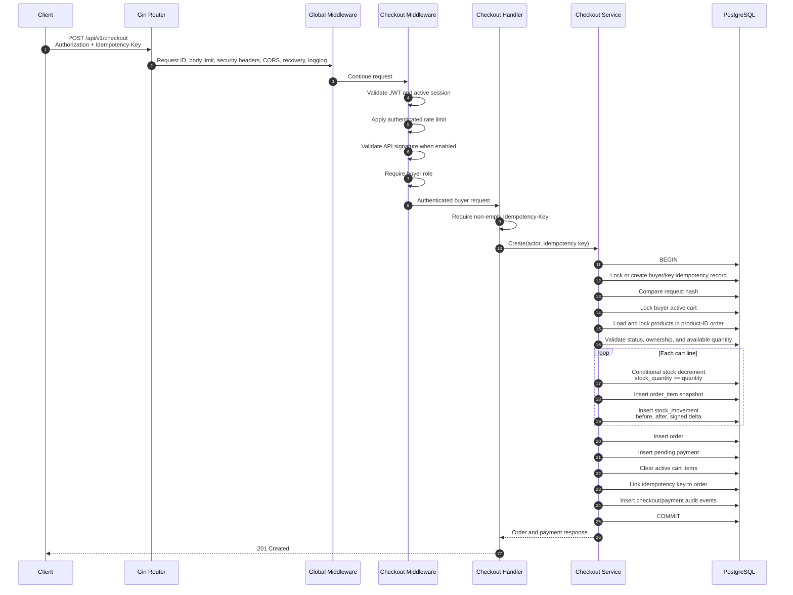
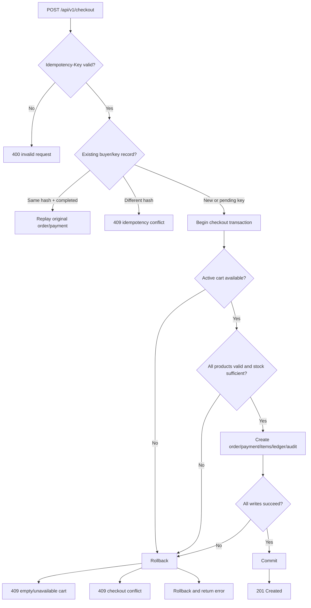

# Checkout Request to Stock Reservation

This document traces the implemented HTTP checkout flow from the incoming request to the PostgreSQL stock decrement and stock ledger write.

## Scope

The flow covers:

- `POST /api/v1/checkout`;
- authentication and route protections;
- buyer/cart/idempotency validation;
- product row locking and conditional stock decrement;
- order, payment, order-item, stock-ledger, and audit writes;
- commit and rollback behavior.

Payment-provider webhook processing is a separate flow documented in [ADR-0011](../ADR/0011-payment-webhook-and-state-transitions.md).

## Request contract

```text
POST /api/v1/checkout
Authorization: Bearer <access-token>
Idempotency-Key: <client-generated-key>
```

The request body is empty for the initial checkout slice. The server derives the buyer and active cart from the authenticated actor; the client does not provide `buyer_id`, `cart_id`, product IDs, or quantities.

## Happy-path request flow



## Where stock actually decreases

Stock is not reserved when the buyer adds an item to the cart. It decreases during checkout inside the PostgreSQL transaction:

```sql
UPDATE products
SET stock_quantity = stock_quantity - $quantity
WHERE id = $product_id
  AND stock_quantity >= $quantity;
```

The implementation checks `RowsAffected`:

- `1` row updated: stock reservation succeeds;
- `0` rows updated: stock is insufficient or the row no longer satisfies the condition, so checkout fails and the transaction rolls back.

For each successful decrement, the same transaction writes a `stock_movements` row containing:

- product ID;
- order and order-item IDs;
- actor/buyer ID;
- movement type `checkout`;
- negative quantity delta;
- `stock_before`;
- `stock_after`;
- reason `checkout stock reservation`.

`products.stock_quantity` remains the current balance. `stock_movements` is the append-only history of inventory changes.

## Transaction boundary

The following state changes commit together:

| Operation | Storage | Transaction boundary |
| --- | --- | --- |
| Idempotency claim/linkage | `checkout_idempotency_keys` | Checkout transaction |
| Active cart lock/read | `carts` | Checkout transaction |
| Product row lock/read | `products` | Checkout transaction |
| Stock decrement | `products.stock_quantity` | Checkout transaction |
| Order creation | `orders` | Checkout transaction |
| Immutable item snapshot | `order_items` | Checkout transaction |
| Payment initialization | `payments` | Checkout transaction |
| Inventory ledger | `stock_movements` | Checkout transaction |
| Audit events | `audit_events` | Checkout transaction |
| Cart item removal | `cart_items` | Checkout transaction |

If any operation fails before commit, all of these writes roll back. This prevents an order, payment, or stock ledger from existing without the corresponding stock mutation.

## Idempotency and retry behavior



Concurrent requests using the same buyer and idempotency key serialize on the PostgreSQL-backed idempotency record. A successful retry replays the existing order instead of decrementing stock a second time.

Concurrent requests for the same product lock product rows in deterministic internal product-ID order and still rely on the conditional decrement to prevent overselling.

## Important boundaries

- No external payment-provider call is made inside this checkout transaction.
- Payment-provider callbacks enter through `POST /webhooks/payment` and use the separate webhook/state-transition flow.
- The audit write is direct to the final `audit_events` table; there is no audit outbox or custom metrics endpoint in the assessment scope.
- Redis is used for request/security controls, not as the source of truth for order or stock state.

## Source-code map

- Route and middleware composition: `internal/modules/checkout/route.go`
- HTTP handler: `internal/modules/checkout/handler.go`
- Checkout service: `internal/modules/checkout/service.go`
- Checkout transaction and stock mutation: `internal/modules/checkout/repository.go`
- Audit writer: `internal/platform/audit/audit.go`
- Checkout schema: `migrations/`
- Stock concurrency decision: `docs/ADR/0002-stock-concurrency.md`
- Checkout/idempotency decision: `docs/ADR/0010-checkout-idempotency-and-order-creation.md`
- Payment webhook/state transitions: `docs/ADR/0011-payment-webhook-and-state-transitions.md`
