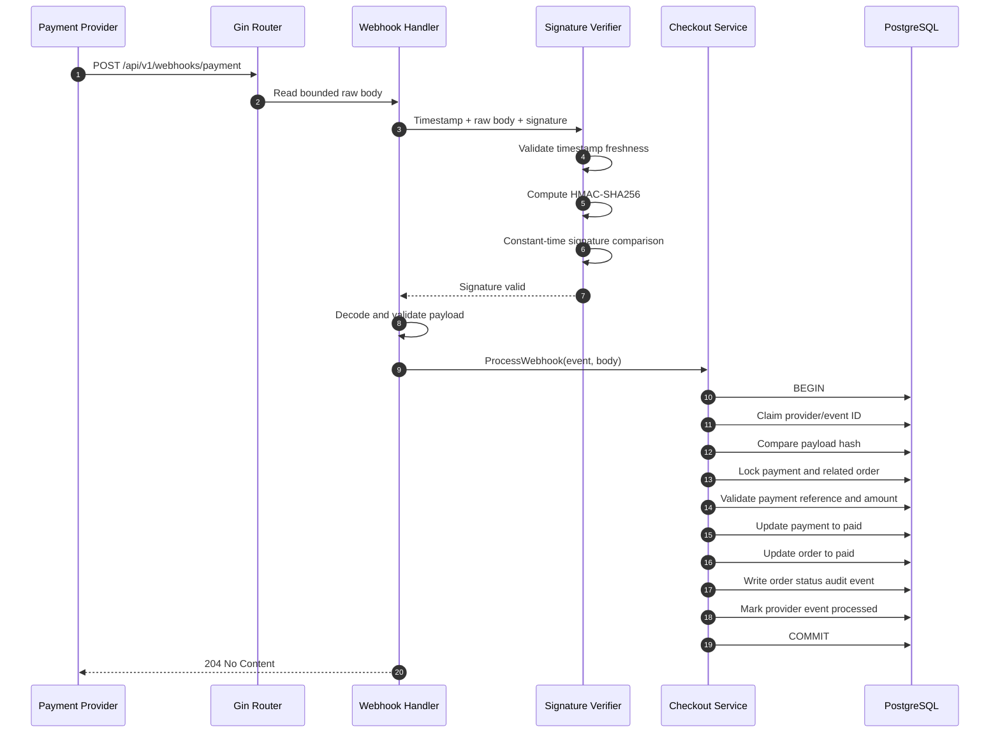
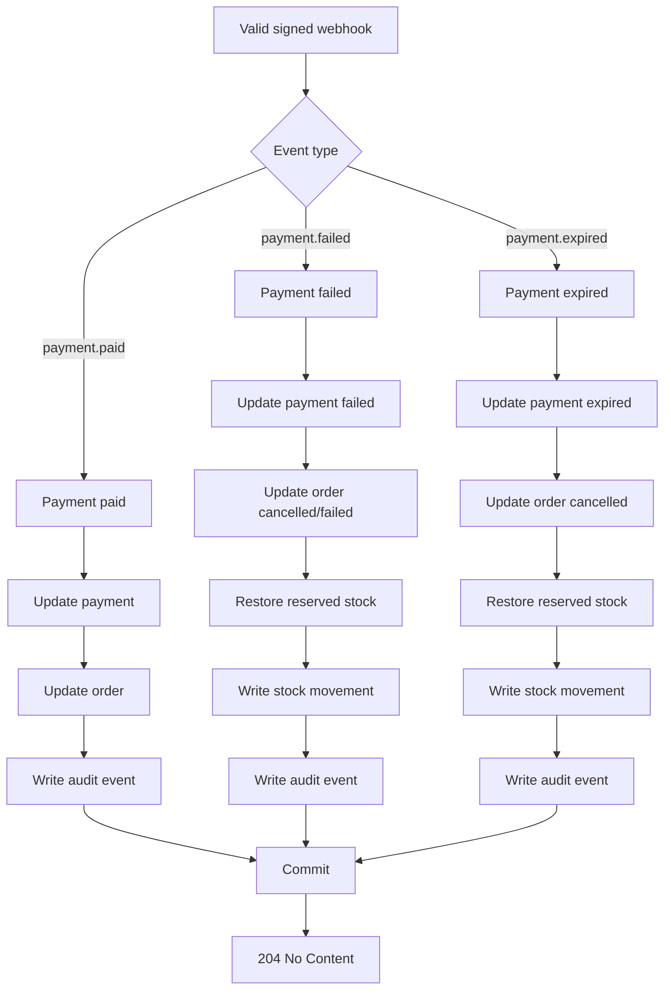

# Payment Webhook State Transition

This document traces the untrusted payment-provider callback from signature verification to payment/order state transition and stock restoration.

## Scope

```text
POST /api/v1/webhooks/payment
```

The endpoint does not use buyer Bearer authentication. Trust comes from the configured webhook secret, a signed raw request body, timestamp freshness, and provider-event idempotency.

## Request contract

```text
Content-Type: application/json
X-Payment-Timestamp: <unix-seconds>
X-Payment-Signature: <hex-hmac-sha256>
```

The signed message is:

```text
<timestamp>.<raw-request-body>
```

The payload contains a bounded provider event ID, event type, payment reference, amount, and occurred timestamp.

## Happy path: payment paid



## Expired or failed payment



## Replay and rejection behavior

| Condition | Result |
| --- | --- |
| Missing/malformed signature | Reject before payment lookup |
| Stale timestamp | Reject before state mutation |
| Signature mismatch | Reject before state mutation |
| New provider event | Process in one PostgreSQL transaction |
| Same event ID and same payload hash | Return successful replay; no second transition |
| Same event ID and different payload hash | Conflict; no mutation |
| Unknown payment reference | Stable not-found/invalid response; no rows created |
| Amount mismatch | Conflict; payment/order remain unchanged |
| Transaction failure | Roll back event claim and business transition |

## Transaction boundary

For a new valid event, these writes commit together:

- provider event inbox record;
- payment status;
- order status and timestamps;
- stock restoration when applicable;
- `stock_movements` ledger row when stock is restored;
- `audit_events` row.

The provider callback is acknowledged only after the transaction succeeds. The API does not call the external provider from inside the database transaction.

## Security rules

- Preserve the exact raw body for signature verification.
- Never log the webhook secret, signature, or raw sensitive payment payload.
- Use constant-time signature comparison.
- Keep webhook authentication separate from API Bearer authentication.
- Enforce a freshness window to prevent old signed requests from being replayed.
- Use `(provider, event_id)` and payload hash to make provider retries idempotent.

## Source-code map

- Route and middleware: `internal/modules/checkout/route.go`
- Webhook handler and raw-body validation: `internal/modules/checkout/handler.go`
- Webhook processing: `internal/modules/checkout/service.go`
- Payment/order state transaction: `internal/modules/checkout/repository.go`
- Webhook signature middleware: `internal/modules/checkout/webhook.go`
- Webhook decision: `docs/ADR/0011-payment-webhook-and-state-transitions.md`
- Stock concurrency decision: `docs/ADR/0002-stock-concurrency.md`
