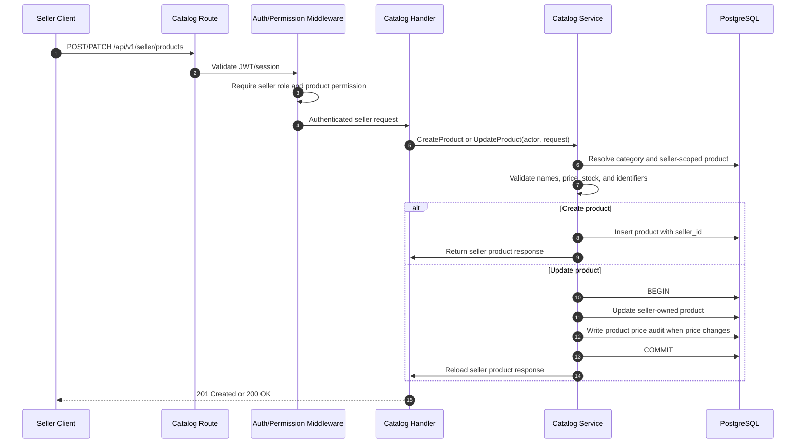
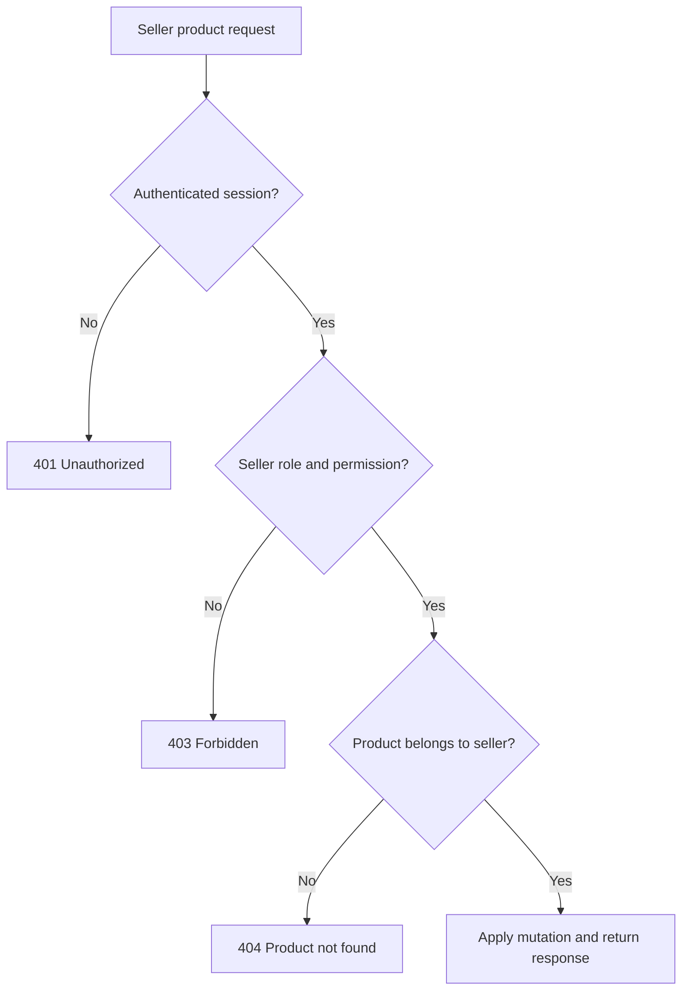

# Seller Product Lifecycle

This document traces seller product mutations from HTTP authorization through product persistence and audit behavior.

## Product create/update flow

## Authorization boundary

The seller ID is derived from the authenticated actor. It is not accepted as a trusted request field. Update queries include seller ownership so a seller cannot mutate another seller's product by changing a public identifier.

## Product and stock semantics

- Product creation sets the seller ownership, category, active status, price, and initial stock.
- Product update validates all resulting values before persistence.
- A price change creates a bounded `product.price_changed` audit event in the same update transaction.
- Product stock is the current catalog balance; checkout performs the transactional stock reservation.
- Cart and checkout flows must not trust seller-provided ownership fields from the request body.

## Source-code map

- Routes and seller authorization: `internal/modules/catalog/route.go`
- HTTP handlers: `internal/modules/catalog/handler.go`
- Validation and service orchestration: `internal/modules/catalog/service.go`
- Seller-scoped persistence and price audit: `internal/modules/catalog/repository.go`
- Product authorization decision: `docs/ADR/0008-seller-product-read-and-ownership-authorization.md`
- Checkout stock mutation: [Checkout request to stock reservation](checkout-stock-reservation.md)
